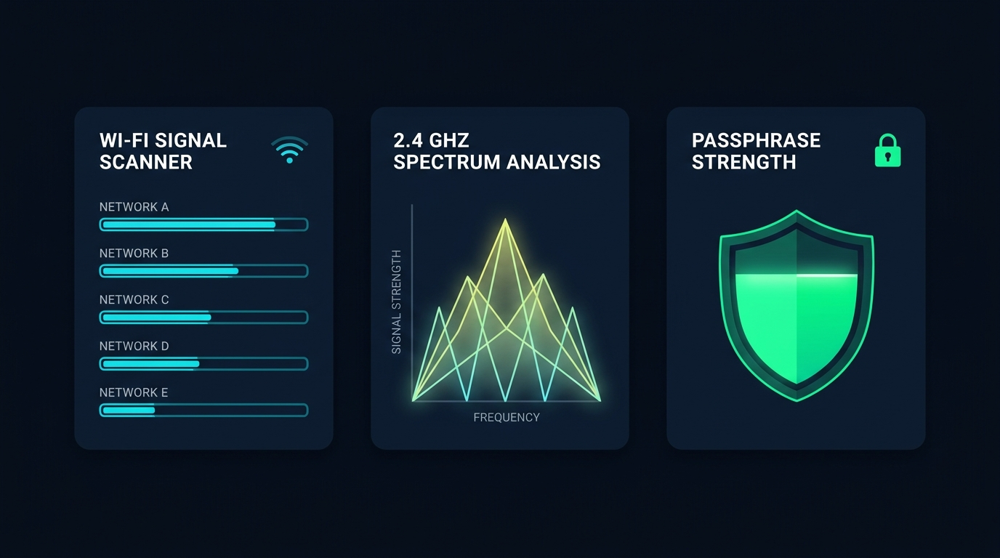
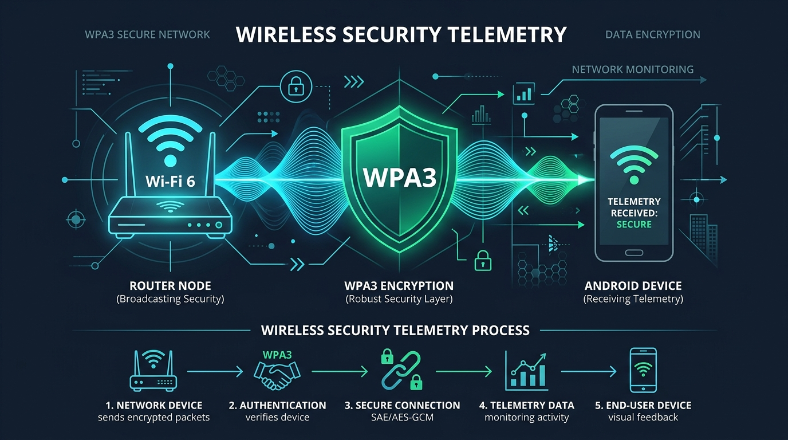

<div align="center">


# NetPulse Wi-Fi

**RF Telemetry, Channel Congestion Visualizer & Security Analyzer for Android**

[](https://kotlinlang.org/)
[](https://developer.android.com/jetpack/compose)
[-10B981?style=for-the-badge&logo=android&logoColor=white)](https://developer.android.com/)
[](https://developer.android.com/)

</div>

---

## Overview

**NetPulse Wi-Fi** is a modern Android network diagnostics and wireless security auditing application built with **Jetpack Compose**, **Material Design 3**, **Coroutines/StateFlow**, and **Clean Architecture**. It empowers users to inspect real-time Wi-Fi signal strength, identify congested 2.4 GHz and 5 GHz channels, audit nearby encryption protocols, and test the strength of their own router passphrases completely offline.

---

## Visual Showcase

<div align="center">



</div>

| Module | Capabilities |
| :--- | :--- |
| **Live Scanner** | Scans nearby access points via `WifiManager`, displays SSID, BSSID, RSSI (`dBm`), signal percentage, frequency (`MHz`), channel number, and security protocol badges (`WPA3`, `WPA2`, `OWE`, `WPA`, `WEP`, `Open`). |
| **Active Link Telemetry** | Monitors the currently connected Wi-Fi network via `ConnectivityManager.NetworkCallback`, showing live link speed (`Mbps`), band, channel, and local IPv4 address. |
| **Channel Spectrum** | Plots parabolic 2.4 GHz channel overlap lobes (Channels 1–13) and 5 GHz access point density using custom Jetpack Compose `Canvas` graphics, recommending the least congested non-overlapping channels (`1`, `6`, `11`). |
| **Security & Passphrase Auditor** | Summarizes nearby network encryption posture and provides an offline entropy & pattern checker to help users harden their own Wi-Fi router passphrases. |
| **Single-Network Connect** | Allows explicit, user-initiated connection to a chosen network on Android 10+ using the official `WifiNetworkSpecifier` and `ConnectivityManager.requestNetwork` APIs. |

---

## Security & Architecture

<div align="center">



</div>

### Clean Architecture Layers

- **Domain Layer (`domain/`)**
  - `WifiModels.kt`: Immutable domain models for scanned access points, active link telemetry, channel congestion scores, passphrase audit results, and sealed connection UI states.
  - `WifiTelemetryAnalyzer.kt`: Pure, unit-tested RF and security calculations (IEEE 802.11 frequency-to-channel mapping, RSSI normalization, overlap-aware 2.4 GHz interference scoring, capabilities parsing, and local passphrase entropy evaluation).
- **Data Layer (`data/`)**
  - `WifiRepository.kt`: Bridges Android `WifiManager` scan broadcasts, `ConnectivityManager` callbacks, hardware/permission readiness checks, and single-network `WifiNetworkSpecifier` requests into reactive `StateFlow` streams.
- **UI Layer (`ui/`)**
  - `WifiAnalyzerViewModel.kt`: Combines repository telemetry with search, band/risk filters, and passphrase audit inputs.
  - `ScannerScreen.kt`, `ChannelsScreen.kt`, `SecurityScreen.kt`: Adaptive Compose screens supporting both compact phones (`NavigationBar`) and tablets/foldables (`NavigationRail`).

---

## Required Android Permissions

NetPulse Wi-Fi requests only the permissions strictly required by the Android platform for local Wi-Fi diagnostics:

| Permission | Purpose |
| :--- | :--- |
| `ACCESS_WIFI_STATE` & `CHANGE_WIFI_STATE` | Read Wi-Fi radio state, scan results, and trigger foreground scans. |
| `ACCESS_NETWORK_STATE` | Observe active Wi-Fi link capabilities and IPv4 address via `ConnectivityManager`. |
| `ACCESS_FINE_LOCATION` & `ACCESS_COARSE_LOCATION` | Required by Android OS (API 29+) to access `WifiManager.scanResults` and connected SSID/BSSID telemetry. |
| `NEARBY_WIFI_DEVICES` | Declared for Android 13+ (API 33+) Wi-Fi hardware discovery compatibility. |

> **Note on Android Scan Throttling:** Android 9+ limits foreground apps to 4 active `startScan()` calls per 2 minutes. NetPulse handles throttling gracefully by displaying the most recent cached scan results with a non-intrusive notice.

---

## Build & Test

Verify compilation and run the local JVM + Robolectric test suite using Gradle:

```bash
# Assemble debug APK
gradle :app:assembleDebug

# Run unit and Robolectric tests
gradle :app:testDebugUnitTest
```

---

## Releasing APKs via GitHub Actions

This repository includes automated GitHub Actions workflows (`.github/workflows/release-apk.yml` and `.github/workflows/android-ci.yml`) to test, build, and publish APKs directly to **GitHub Releases**.

### Option 1: Release by Pushing a Version Tag
```bash
git tag v1.0.0
git push origin v1.0.0
```
GitHub Actions will automatically run tests, build the APK, and attach it to a new GitHub Release for `v1.0.0`.

### Option 2: Manual Release from GitHub UI
1. Open your repository on GitHub and go to the **Actions** tab.
2. Select **Release Android APK** from the left sidebar.
3. Click **Run workflow**, optionally enter a tag (e.g. `v1.0.0`), and click **Run workflow**.

### Signed Release APKs (Recommended for Production)
Without extra configuration, the release workflow publishes a testable `debug`-signed APK. To publish a **production-signed Release APK**, add these three secrets under **Settings → Secrets and variables → Actions**:

| GitHub Secret | Description |
| :--- | :--- |
| `KEYSTORE_BASE64` | Base64-encoded `.jks` upload keystore (`base64 -w 0 my-upload-key.jks`) with key alias `upload`. |
| `STORE_PASSWORD` | Password for your keystore file. |
| `KEY_PASSWORD` | Password for the `upload` key alias. |

---

## Responsible Use

NetPulse Wi-Fi is designed strictly for **legitimate network diagnostics, RF channel optimization, and defensive wireless security auditing**. All telemetry processing and passphrase strength checks run locally on-device with zero external data collection.
